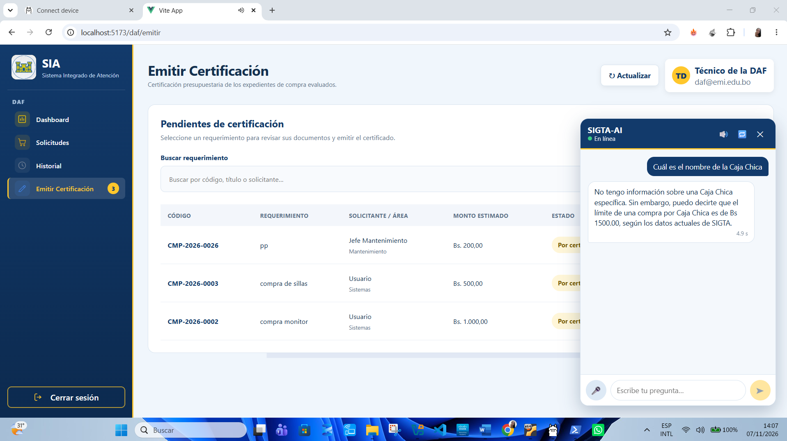

# Manual de usuario: Asistente virtual de SIGTA

**Sistema:** SIGTA, Escuela Militar de Ingeniería, Unidad Académica Santa Cruz
**Versión del documento:** 1.0
**Fecha:** 07/11/2026

---

## 1. ¿Qué es el asistente virtual?

Es un ayudante que está dentro de SIGTA y responde preguntas sobre el sistema y sobre tus trámites: tickets de soporte técnico, requerimientos de mantenimiento y solicitudes de compra de Caja Chica.

Puedes hablarle de dos formas:
- **Escribiendo** tu pregunta.
- **Hablando** por el micrófono. El asistente también te responde en voz alta.

El asistente solo te muestra información que tú ya puedes ver en el sistema con tu usuario.

> En la pantalla, el sistema aparece con el nombre **SIA (Sistema Integrado de Atención)** y el asistente como **SIGTA-AI**.

## 2. Antes de empezar

- Usa **Google Chrome** o **Microsoft Edge**. En Firefox la función de voz no está disponible (el chat por texto sí funciona).
- Para usar la voz necesitas un **micrófono** y **parlantes o audífonos**.
- Debes haber **iniciado sesión** en SIGTA.

## 3. Abrir el asistente

1. Inicia sesión en SIGTA con tu correo y contraseña.
2. En cualquier pantalla, busca el **botón redondo azul con borde amarillo en la esquina inferior derecha** (tiene el dibujo de un robot).
3. Haz clic en el botón para abrir la ventana del asistente. Arriba verás **SIGTA-AI** y un punto de color:
   - 🟢 **En línea**: el asistente está listo.
   - 🔴 **Sin conexión** o **Modelo no instalado**: el servicio de IA no está disponible; avisa a UTIC.

## 4. Hacer una consulta por texto

1. Escribe tu pregunta en el campo de texto de la parte inferior de la ventana.
2. Presiona **Enter** o el botón **Enviar**.
3. Mientras el asistente piensa, verás un indicador de espera.
4. La respuesta aparece en la conversación y también se lee en voz alta (puedes silenciarla, ver sección 6).

*Figura 1. Consulta por texto. El asistente responde según los permisos de cada usuario: la DAF no gestiona tickets de soporte, por eso no ve ninguno. Debajo de cada respuesta se muestra cuánto tardó.*

## 5. Hacer una consulta por voz

1. Haz clic en el botón del **micrófono** 🎤.
2. **La primera vez**, el navegador te pedirá permiso para usar el micrófono. Haz clic en **Permitir**.
3. Cuando el botón del micrófono se ponga **rojo y con un pulso**, habla con claridad. Mientras hablas, tus palabras aparecen en el campo de texto.
4. Al terminar de hablar, tu pregunta aparece escrita en el chat y **se envía sola**.
5. El asistente responde en pantalla y en voz alta.

*Figura 2. Consulta por voz. El reconocimiento escribió "nombre" en lugar de "límite"; aun así, el asistente entendió y dio el límite correcto. Si tu pregunta se transcribe mal, puedes corregirla escribiendo.*

**Consejos para que te entienda mejor:**
- Habla a velocidad normal y cerca del micrófono.
- Evita lugares con mucho ruido.
- Haz una pregunta a la vez.

## 6. Controles de audio

| Botón | Qué hace |
|---|---|
| 🔇 Silenciar | Detiene la lectura en voz alta. Las respuestas se siguen mostrando en pantalla |
| 🔁 Repetir | Vuelve a leer en voz alta la última respuesta |
| ✕ Cerrar (o tecla **Esc**) | Cierra el chat y detiene el micrófono y el audio. La conversación se conserva hasta que cierres sesión |

## 7. Ejemplos de preguntas

| Tema | Ejemplo |
|---|---|
| Uso del sistema | "¿Cómo creo un ticket de soporte?" |
| Estado de trámites | "¿En qué estado está mi último ticket?" |
| Mantenimiento | "¿Tengo requerimientos de mantenimiento pendientes?" |
| Compras | "¿Cuál es el límite de una compra por Caja Chica?" |
| Procedimientos | "Mi proyector no enciende, ¿qué hago?" |

> Las preguntas sobre **cantidades y listas largas** pueden tener errores (ver sección 8). Para datos importantes, confirma siempre en la pantalla correspondiente.

## 8. Problemas frecuentes

| Problema | Qué hacer |
|---|---|
| No veo el botón del asistente | Verifica que iniciaste sesión. Recarga la página (F5) |
| El micrófono no funciona | Haz clic en el **candado** junto a la dirección web → **Micrófono** → **Permitir**, y recarga la página |
| No aparece el botón del micrófono | Tu navegador no soporta voz. Usa Chrome o Edge, o escribe tu pregunta |
| No escucho la respuesta | Revisa el volumen del equipo y que el asistente no esté silenciado |
| El micrófono escribe otra palabra | Habla más despacio y cerca del micrófono. Si la pregunta se envió mal, vuelve a hacerla escribiéndola en el campo de texto |
| "El asistente no está disponible en este momento" | El servicio de IA está apagado. Avisa a UTIC |
| La respuesta tarda mucho | La primera consulta del día puede demorar más; espera unos segundos |
| La respuesta no es correcta | El asistente puede equivocarse. Verifica siempre la información importante en las pantallas del sistema |

## 9. Buen uso

- El asistente **orienta**, pero no reemplaza los procedimientos oficiales ni las aprobaciones del sistema.
- No escribas contraseñas ni datos sensibles en el chat.
- Si usas la voz en Chrome o Edge, el navegador procesa el audio en línea para convertirlo a texto.
